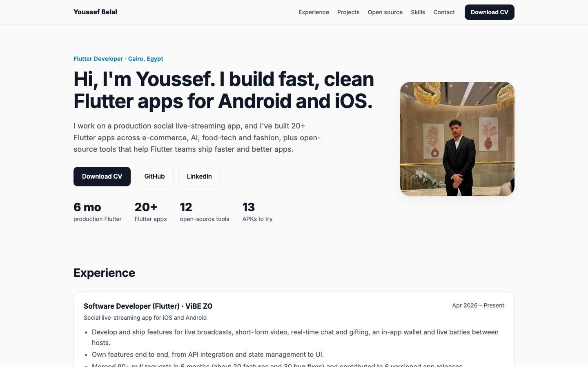

<h1 align="center">Portfolio</h1>

<p align="center">
  My personal site: experience, featured Flutter projects, open-source Flutter tools and Android builds you can install.
</p>

<p align="center">
  
  <br/><sub>Live site: youssef336.github.io</sub>
</p>

<p align="center">
  <a href="https://youssef336.github.io"><b>Live site</b></a> ·
  <a href="https://github.com/youssef336/portfolio/releases/tag/apps">APK downloads</a> ·
  <a href="cv/Youssef_Belal_CV.pdf">CV</a>
</p>

## About

A single static page (plain HTML and CSS, no framework, no build step, no JavaScript), deployed on GitHub Pages at [youssef336.github.io](https://youssef336.github.io) (the old Vercel link mirrors it).
It follows the system light/dark theme and works from phone width up.

Sections: hero with CV download, experience, featured projects (Xspire / MysteryBag, Fruits Hub, StyleBox,
Fashion Store), 12 open-source Flutter tools, more apps with APK downloads, skills, education and contact.

## Roadmaps

Two beginner-friendly learning roadmaps live on the site, each with Arabic and English video courses (free and paid,
tagged), documentation links per topic, a practice project per phase and progress saved in the browser:

- Data Analyst Roadmap: https://youssef336.github.io/data-analysis-roadmap/
- Frappe / ERPNext Developer Roadmap: https://youssef336.github.io/frappe-roadmap/
- Hub page listing both: https://youssef336.github.io/roadmaps/

They share one stylesheet and script in `roadmaps/assets/` (light/dark theme, print styles, mobile layout,
"next step" banner, shareable progress links like `#done=1,2,3`, per-phase resource counters, EN/AR phase titles).
A weekly GitHub Action (`.github/workflows/link-check.yml`) checks every link and opens an issue when one breaks.

## APKs

The Android builds are attached to the [`apps` release](https://github.com/youssef336/portfolio/releases/tag/apps), not
committed to the repo, so the site stays small and every download is the real file. Each button links to
`releases/download/apps/<file>.apk`. To update an app, upload the new APK to that release with the same file name:

```bash
gh release upload apps path/to/notes_app.apk --clobber -R youssef336/portfolio
```

## Project structure

```
portfolio/
├── index.html   # the whole page
├── styles.css   # layout, light/dark theme, responsive breakpoints
├── favicon.svg
├── cv/          # downloadable CV (PDF)
├── images/      # project images and profile photo
├── roadmaps/    # roadmaps hub + shared assets (roadmap.css, roadmap.js)
├── data-analysis-roadmap/   # Data Analyst roadmap page + og.png
└── frappe-roadmap/          # Frappe / ERPNext roadmap page + og.png
```

## Run locally

```bash
git clone https://github.com/youssef336/portfolio.git
cd portfolio
python3 -m http.server 8000   # then open http://localhost:8000
```

## Author

**Youssef Belal** · [GitHub @youssef336](https://github.com/youssef336) ·
[LinkedIn](https://www.linkedin.com/in/youssef-belal-509385294/)
